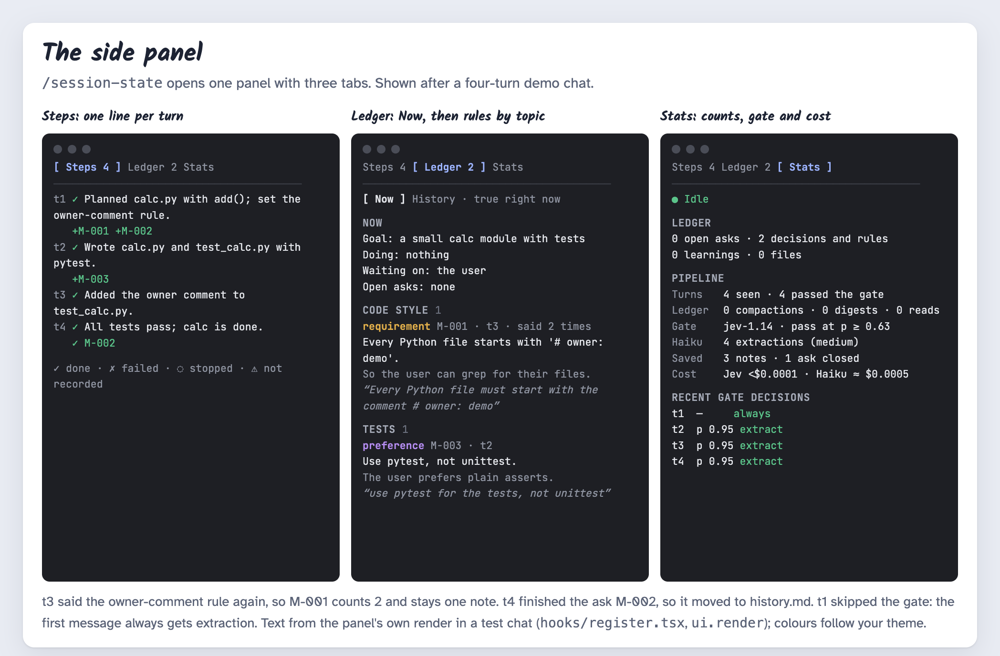
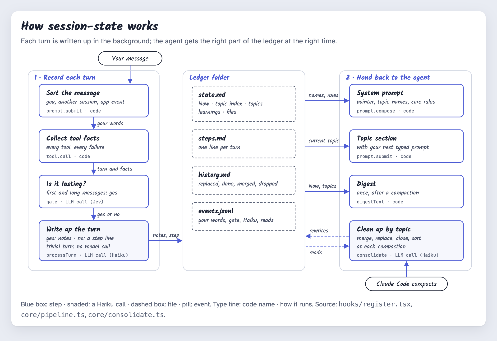
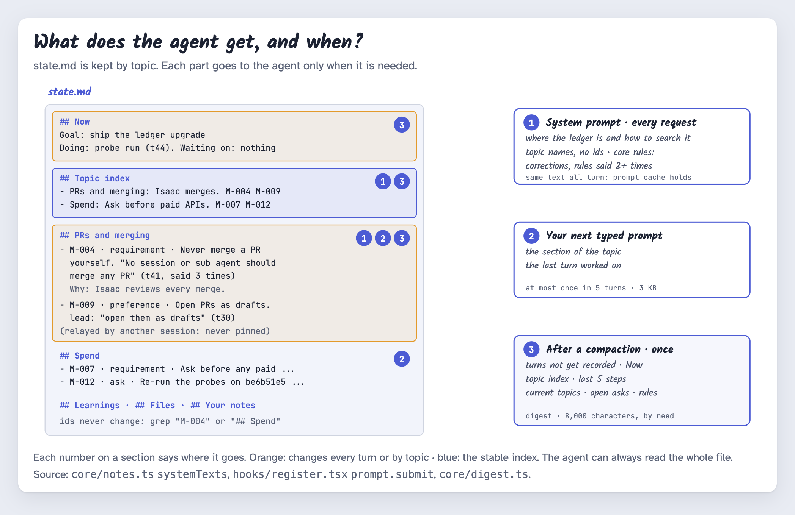

# session-state

A Claude Code mod that keeps a ledger of a long chat, so the agent does not forget what you asked, what you decided, what it learned the hard way, and which files matter. It writes the ledger after every turn, tells the agent where it is, and hands it back right after Claude Code compacts the chat. A side panel shows one line per turn.

The mod never changes, starts or blocks compaction. It only notices that one happened.

## Install

In a Claude Code terminal session:

```
/plugin install session-state --marketplace kargarisaac/session-state
```

Answer `y` to add the marketplace, pick a scope, and paste your OpenRouter key when asked (it is stored as a secret). From a shell instead:

```bash
claude plugin install session-state --marketplace kargarisaac/session-state
```

The mod is active right away in that session and in every session you start after. After an update, run `/reload-plugins`. To try it from a clone without installing: `claude --plugin-dir <folder>`.

No OpenRouter key? Set the `gate` setting to `off` (see Privacy).

## Use

Work as usual. Then:

- `/session-state` opens one side panel with three tabs at the top (press `1`, `2` or `3`, or click): **Steps** (each turn with its outcome, files and the notes it added), **Ledger** (open asks, decisions and rules, learnings and files, colour-coded by kind, rules suggested for `AGENTS.md`, with a switch between *Now* and *History*) and **Stats** (recorder status, counts, compactions, digests delivered, ledger reads by the agent, models, cost and recent gate decisions). Colours come from your Claude Code theme.
- `/session-state steps | ledger | stats` opens the panel on that tab.
- `/session-state close | pause | resume | retry | path | digest` closes the panel, stops recording, resumes, re-runs failed turns, prints the folder, or prints what the agent gets after a compaction.
- `/session-state rebuild` moves the chat's ledger files to `before-rebuild/` (`before-rebuild-2/` and on, for the next rebuilds) and reads the whole chat again from Claude Code's transcript. It leaves the files alone when the transcript has no turns to read, or when the chat continues one that was compacted under a new session id (its transcript starts after the compaction, so the earlier turns are only in the ledger).
- Ask the agent "what did I decide about X?" and it reads the ledger.

The panel reads `state.md`, `steps.md` and `history.md` again when they change, so a hand edit shows without reopening it. Closing the panel, or asking for a tab, takes the Ledger tab back to `state.md`.



**Steps** has one line per turn, with what the tools did and what the turn added (`+M-002`) or finished (`✓ M-002`). **Ledger** shows the Now block, open asks, then the rules by topic with how often you said each one, rules suggested for `AGENTS.md`, learnings and files. **Stats** shows the gate's decisions, how many turns got a summary or an extraction, compactions, digests delivered, the agent's reads of the ledger, and the cost.

Each chat gets a folder, `~/.claude/session-state/<project>/<date>_<id8>/`, with an `INDEX.md` per project:

| File | Holds |
| --- | --- |
| `state.md` | What is true now: a **Now** block (goal, current task, who the chat waits on, open asks), a **topic index**, one section per topic with its notes, then learnings, files and "Your notes". Edit or delete a note by hand and the change sticks; lines under "Your notes" are kept. |
| `steps.md` | One line per turn, never rewritten: `- t41 · ✓ · Moved the parser to its own file · edited core/parse.ts · 3 commands · 4 Claude_Browser · +M-012 · done M-009`. ✗ failed, ◌ stopped, ⚠ not recorded. |
| `history.md` | Notes that left `state.md`: replaced, done, merged into another note, or dropped, each with the reason. |
| `suggestions.md` | Rules also found in other chats of this project, for you to copy to `AGENTS.md`. |
| `events.jsonl` | Each turn as it was (redacted, clipped, with its tool facts), each gate and Haiku run, compactions, digests and the agent's reads of the ledger. |

Part of a `state.md`:

```
## Now
Goal: ship the ledger upgrade
Doing: probe run (t44). Waiting on: nothing
Open asks: M-012

## Topic index
- PRs and merging: Isaac merges; sessions open drafts. M-004 M-009
- Spend: Ask before paid APIs. M-007 M-012

## PRs and merging
- M-004 · requirement · Never merge a PR yourself. "No session or sub agent should merge any PR" (t41, said 3 times) <!-- {"turn":12,"turnId":"u12"} -->
  Why: Isaac reviews every merge.

- M-009 · preference · Open PRs as drafts. lead: "open them as drafts" (t30) <!-- {"turnId":"u30","via":"lead"} -->
```

Each note is one line: what to do, your exact words, the last turn you said it and how often. Ids never change, so a search for `M-004` always finds it. The comment keeps the fields the line does not show. `M-009` came in a message from another Claude session ("lead"), so it is never quoted as you and never pinned. A `state.md` from an older version still reads: its notes show under "Unsorted" until the next compaction sorts them into topics.

When Claude Code auto-compacts a chat and carries on under a new session id, the new session starts from a copy of the old session's ledger and keeps numbering its turns from there: the folder this session was recording into or, failing that, the folder whose transcript holds the message that the compaction boundary at the top of the new transcript points back to. The agent still gets the digest on your next message. The old folder is left as it was.

A chat the mod meets part-way (installed or upgraded mid-chat, or resumed) is read back from Claude Code's transcript: its last 100 turns are queued like live ones, so each gets a step line and its notes in the background, with the right turn numbers. A mod cannot read a file over 4 MiB, so a chat whose transcript is bigger than that is not read back. Only when no turns can be read back from the transcript (there is none, or it is that big) does a notes file from an older version (`<date>_<id8>.md`) seed the folder. Old files are left as they were.

## How it works



**Every turn** the mod takes what you typed, including messages sent while the agent was working and your answers to its multiple-choice questions. App events (task notifications, CI and side-session events, slash-command output) make no turn, and `<system-reminder>` blocks are removed first. A message from another Claude session is recorded, but its notes say `Via: <session name>`: they are never quoted as you and never pinned. The mod records what the main agent's tools did (files read and edited, every other tool by name, any tool that failed, commits) and archives the turn. **Jev** (a yes/no decision model on OpenRouter) reads your message, the agent's reply and the end of the previous reply, and decides whether you said something that will still matter 50 turns later. The first message of a chat and any message over 600 characters skip Jev and always get extraction: they usually set the task and its rules. Then at most one **Haiku** call runs on your Claude Code login (plan usage, not billed):

- **Summarization**, when Jev says no, at low effort with a small context (the Now block, open asks, topic names, the last 5 steps and 3 messages): the step line, the Now block, which open asks the reply finished, a role for each newly edited file, and any learning (an approach that failed, or a hard limit), quoted from the reply or a failed command.
- **No call at all** when Jev says no and the turn used no tool except reads and the reply is under 1,500 characters: code writes the step line from your words (`Asked: ...`).
- **Extraction**, when Jev says yes (or Jev is off or down), at the set effort (medium by default): all of the above, plus notes about what you said: decisions, rules, preferences, corrections and asks, each with a topic. Each note has a short title, why, context, your exact words and its source turn. When you say a rule again, Haiku names the note instead of adding a copy, and its count goes up; code also counts a note as a repeat when its quote mostly matches one in the same topic. If your message only makes sense with an older turn or another topic ("do what I said about the deck"), Haiku may ask once for that turn from the archive or for that topic's section.

For extraction Haiku sees the Now block, the topic index, the sections of the topics the last three turns worked on, open asks, the last 15 steps, your last 10 messages word for word, the whole previous reply and this turn. Each call has its own output cap (12,000 tokens for extraction, 2,000 for a summary); a cut or empty reply is asked again once with a larger cap. Code then checks its answer: a note's quote must be in your message, a learning's evidence in the reply or a failed command, a file role must be for a file edited this turn. Anything else is dropped. A note title over 15 words is cut in code. A turn whose Haiku call fails twice gets a ⚠ step line instead of ✓; `/session-state retry` runs it again.

**What the agent is told, and when.**



1. **The system prompt** holds a fixed pointer line, the topic names with their one-line summaries (no note ids), and your **core rules**: corrections, and rules you said two or more times, newest first, never one relayed by another session. All of it is at most about 3 KB. It is taken once per typed prompt, so it is the same on every request of a turn, and it changes only when a topic or a core rule changes. That keeps Claude Code's prompt cache valid. Turn the rules off with `pinRules`. The pointer line:

   > Session ledger: a tool keeps the state of this conversation in `<folder>/`. state.md has a Now block, a topic index, and one ## \<topic\> section per topic. Notes have permanent ids such as M-012. Grep state.md for a topic heading or id; grep events.jsonl for the user's exact past words. ...

2. **Your next typed prompt** carries the full section of a topic the last turn worked on, when that section was not sent in the last 5 turns (at most 2 topics, about 3 KB).
3. **After a compaction.** Claude Code's summary drops much of what a plugin added and reloads only a few files. When the mod sees the main chat compacted, it attaches a digest of the ledger to the next message you type, once: turns not yet recorded, the Now block, the topic index, the last 5 steps, the sections of the current topics, then open asks and core rules not shown yet. Each part has a share of the 8,000 characters, so the newest items are never cut. A message from a task, a schedule or another session does not use it up. A ledger with nothing in it gives no digest.

**Clean-up at each compaction.** At the same time, one Haiku call reads `state.md`, the last 30 steps and your messages since the last clean-up. It merges notes that say the same thing (the lowest id stays, the counts add up), replaces old rules with newer ones, closes finished asks, drops asks the chat clearly gave up, names the topics and sorts unsorted notes into them. Code checks every change: a rule, decision, preference or correction is never dropped, only merged or replaced; every note that leaves goes to `history.md` with its reason; a bad item is skipped and the rest still applies.

**Speed.** The hooks that run while you wait do no model call and no large write: the turn is written up, and `events.jsonl` saved, by a background job after the turn. The panel reads the files only when they changed.

## Settings

| Setting | Default | Meaning |
| --- | --- | --- |
| `openrouterKey` | empty | Jev key; falls back to `OPENROUTER_API_KEY` |
| `gate` | `jev` | `jev`, or `off` to extract on every turn |
| `threshold` | `0.63` | Jev probability needed for extraction |
| `jevModel` | `jev-1.14` | OpenRouter model id for the gate |
| `haikuModel` / `effort` | `claude-haiku-5-5` / `medium` | Haiku model, and its effort for extraction (summarization is always low) |
| `maxWords` | `15` | Longest note title |
| `auditRate` | `0` | Share of turns below the threshold that get extraction anyway, to check the gate |
| `pinRules` | on | Put your rules in the agent's system prompt |
| `openPanelOnStart` | off | Open the panel with each session |

## Privacy

- With `gate: jev`, each turn's message, answer and the end of the previous answer (keys and tokens redacted, text capped) go to OpenRouter and TypeSafe in the US.
- With `gate: off`, nothing leaves Claude Code; Haiku extracts on every turn and uses more plan quota.
- To find the old ledger of a chat that Claude Code continued under a new session id, the mod searches the old chat's transcript for one message id. A transcript over 4 MiB is too big for the mod to read, so it runs `grep -q` on that one file (by argument vector, no shell, nothing leaves your machine).
- `events.jsonl` keeps each turn's text (redacted, clipped) on your disk, so later turns can still read it after a compaction.
- `prompt.compose` hooks do not run in organization-managed installs: there the agent is not told about the ledger, but the files and panel still work.
- The mod API is early access and may change between Claude Code versions.

## How well it works

**The gate.** Calibrated on 14 real chats (815 turns), labelled by LLMs with no human in the loop. With jev-1.14 and the previous reply in view, the shipped 0.63 keeps 92% of passed turns on target and passes 62% of the important ones; showing the previous reply raised held-out AUC from 0.84 to 0.91. A turn below the threshold is not lost: it still gets a step, and its words stay in the archive. See [eval/REPORT.md](eval/REPORT.md).

**The ledger.** [eval/PROBES.md](eval/PROBES.md) replays real chats through the mod, then asks questions an agent must still answer after a compaction (what you asked, which file, what was decided, what is still open) and grades the answers 0 to 5 with only a compaction-style summary, only the ledger, or both. On two held-out chats (75 turns, 24 questions), summary and ledger together scored 3.54 against 2.83 for the summary alone. The ledger is strongest on what you asked (3.67 alone against 2.17 for the summary) and weakest on what was pending at the very end, which the summary covers. Both miss the agent's own reasons for its choices, which the ledger does not record. The sample is small and Sonnet wrote and graded the questions.

**0.6 against 0.4.** The probe now also grades an "after" condition: the summary plus exactly what the mod injects (system-prompt sections and the digest), which is what the agent has after a compaction if it reads no file. On four chats (48 questions, the same questions, summaries and chat text in every run):

| Run | Summary | Ledger | Both | After |
| --- | --- | --- | --- | --- |
| 0.4 ([baseline](eval/PROBES-baseline.md)) | 2.96 | 2.15 | 3.69 | 3.19 |
| Phase 2 fixes ([report](eval/PROBES-fixes.md)) | 3.10 | 2.27 | 3.40 | 3.19 |
| 0.6 topics ([report](eval/PROBES-topics.md)) | 3.08 | 2.25 | 3.48 | 3.15 |

The "after" score did not change. The summary column gets the identical input in every run and still moves by 0.14, so differences under about 0.15 are grader noise. 0.6 is not better at answering these questions; what it changes is what goes in the ledger (only the person's and other sessions' words, failures marked, newest first in the digest, notes grouped by topic and merged at compaction) and what it costs. With the gate off, 0.6 made 591 Haiku calls for 587 turns: about 17,600 input and 2,150 output tokens a turn. With the gate on, turns below the threshold with no edits or failures get their step from code and no Haiku call.

## Development

`core/` is host-free logic, `hooks/` the Claude Code adapter, `eval/` the calibration and the probe test. Check with `claude plugin validate .` and `claude plugin test .`. To rerun the calibration on your own chats: `bun eval/build.ts`, `label.ts`, `score.ts`, `fit.ts` (set `EVAL_PROJECT_PREFIX` to pick project folders under `~/.claude/projects`; data stays in git-ignored `eval/data/`). The probe test: `bun eval/probe.ts <transcript.jsonl>...`.
