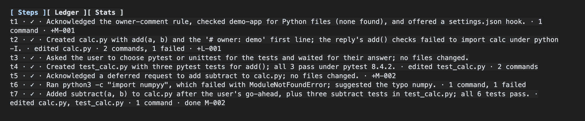
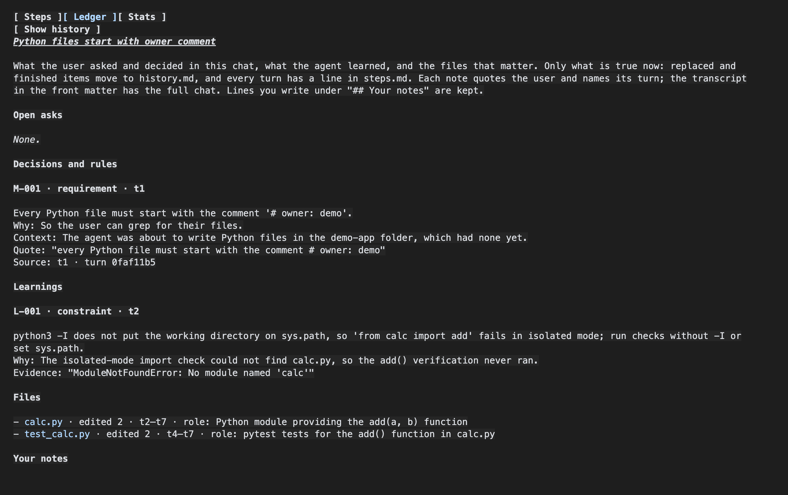
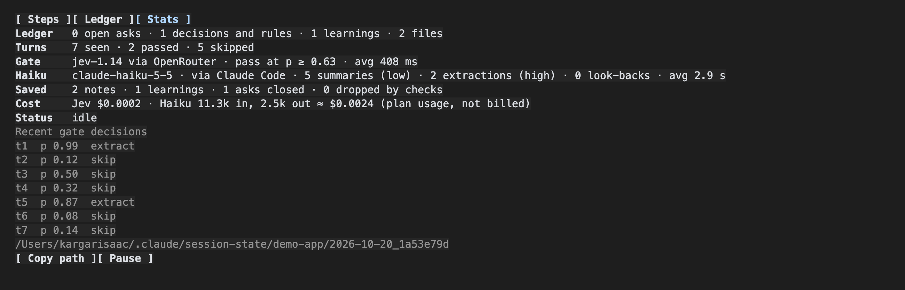
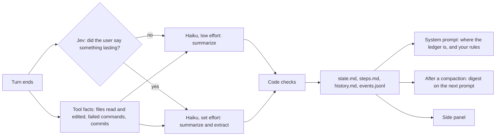

# session-state

A Claude Code mod that keeps a ledger of a long chat, so the agent does not forget what you asked, what you decided, what it learned the hard way, and which files matter. It writes the ledger after every turn, tells the agent where it is, and hands it back right after Claude Code compacts the chat. A side panel shows one line per turn.

The mod never changes, starts or blocks compaction. It only notices that one happened.

## Install

In a Claude Code terminal session:

```
/plugin install session-state --marketplace kargarisaac/session-state
```

Answer `y` to add the marketplace, pick a scope, and paste your OpenRouter key when asked (it is stored as a secret). From a shell instead:

```bash
claude plugin install session-state --marketplace kargarisaac/session-state
```

The mod is active right away in that session and in every session you start after. After an update, run `/reload-plugins`. To try it from a clone without installing: `claude --plugin-dir <folder>`.

No OpenRouter key? Set the `gate` setting to `off` (see Privacy).

## Use

Work as usual. Then:

- `/session-state` opens one side panel with three tab buttons at the top: **Steps** (one line per turn), **Ledger** (`state.md`, with a button for `history.md`) and **Stats** (models, counts, cost).
- `/session-state steps | ledger | stats` opens the panel on that tab.
- `/session-state close | pause | resume | retry | path | digest` closes the panel, stops recording, resumes, re-runs failed turns, prints the folder, or prints what the agent gets after a compaction.
- `/session-state rebuild` moves the chat's ledger files to `before-rebuild/` and reads the whole chat again from Claude Code's transcript.
- Ask the agent "what did I decide about X?" and it reads the ledger.

**Steps:** one line per turn, with what the tools did and what the turn added (`+M-002`) or finished (`done M-002`).



**Ledger:** `state.md` as it stands: open asks, decisions and rules with why and your words, learnings, and the files that matter.



**Stats:** the gate's decision for each turn, how many turns got a summary or an extraction, and the cost.



These come from a 7-turn demo chat. In turn 4 the user answered "the first one" (pytest); Jev scored that short reply 0.32, so it got a step but no note.

Each chat gets a folder, `~/.claude/session-state/<project>/<date>_<id8>/`, with an `INDEX.md` per project:

| File | Holds |
| --- | --- |
| `state.md` | What is true now: open asks, decisions and rules, learnings, files that matter. Edit or delete an item by hand and the change sticks; lines under "Your notes" are kept. |
| `steps.md` | One line per turn, never rewritten: `- t41 · ✓ · Moved the parser to its own file · edited core/parse.ts · +M-012 · done M-009` |
| `history.md` | Items that left `state.md`: replaced by a newer one, or done. |
| `events.jsonl` | Each turn as it was (redacted, clipped, with its tool facts), and each gate and Haiku run. |

A note in `state.md`:

```
### M-012 · decision · t41
Store the ledger as one folder per session, with state.md rewritten and steps.md append-only.
Why: Keeps the current state short while every turn stays on record.
Context: Choosing the layout for the session ledger mod.
Quote: "Folder, split files"
Source: t41 · turn 3f2a9c1b · answers t40
```

When Claude Code auto-compacts a chat and carries on under a new session id, the new session starts from a copy of the old session's ledger (found through the compaction boundary at the top of the new transcript) and keeps numbering its turns from there. The old folder is left as it was.

A chat the mod meets part-way (installed or upgraded mid-chat, or resumed) is read back from Claude Code's transcript: its last 100 turns are queued like live ones, so each gets a step line and its notes in the background, with the right turn numbers. Only when there is no transcript does a notes file from an older version (`<date>_<id8>.md`) seed the folder. Old files are left as they were.

## How it works



**Every turn** the mod takes what you typed, including messages sent while the agent was working and your answers to its multiple-choice questions. It records what the main agent's tools did (files read and edited, commands that failed, commits) and archives the turn. **Jev** (a yes/no decision model on OpenRouter) reads your message, the agent's reply and the end of the previous reply, and decides whether you said something that will still matter 50 turns later. Then one **Haiku** call runs on your Claude Code login (plan usage, not billed):

- **Summarization**, every turn, at low effort: the step line, which open asks the reply finished, a role for each newly edited file, and any learning (an approach that failed, or a hard limit), quoted from the reply or a failed command.
- **Extraction**, when Jev says yes (or Jev is off or down), at the set effort: all of the above, plus notes about what you said: decisions, rules, preferences, corrections and asks. Each note has a short title, why, context, your exact words and its source turn. If your message only makes sense with an older turn ("do what I said about the deck"), Haiku may ask for that turn once from the archive.

Haiku sees the ledger, the last 15 steps, your last 10 messages word for word, the whole previous reply and this turn. Code then checks its answer: a note's quote must be in your message, a learning's evidence in the reply or a failed command, a file role must be for a file edited this turn. Anything else is dropped.

**What the agent is told.** Two things go into the system prompt. A fixed line, the same on every request, so it costs one cache write:

> Session ledger: a tool keeps a ledger of this conversation in `<folder>/`. state.md holds what is true now: the user's open asks, their decisions and rules with the reason and their exact words, what was learned the hard way, and the files that matter with their roles. steps.md has one line per turn; history.md has replaced and finished items. ...

And your rules: the active `requirement` and `preference` notes (the newest 8). That part changes only when a rule is added or removed. Turn it off with `pinRules`.

**After a compaction.** Claude Code's summary drops much of what a plugin added and reloads only a few files. When the mod sees the main chat compacted, it attaches a digest of the ledger (open asks, rules, learnings, files, recent steps; at most 8,000 characters, each note cut short) to the next message you type, once. A message from a task, a schedule or another session does not use it up. Turns still being recorded are not in the ledger yet, so the digest lists your messages from them first. A ledger with nothing in it gives no digest.

## Settings

| Setting | Default | Meaning |
| --- | --- | --- |
| `openrouterKey` | empty | Jev key; falls back to `OPENROUTER_API_KEY` |
| `gate` | `jev` | `jev`, or `off` to extract on every turn |
| `threshold` | `0.63` | Jev probability needed for extraction |
| `jevModel` | `jev-1.14` | OpenRouter model id for the gate |
| `haikuModel` / `effort` | `claude-haiku-5-5` / `high` | Haiku model, and its effort for extraction (summarization is always low) |
| `maxWords` | `15` | Longest note title |
| `auditRate` | `0` | Share of turns below the threshold that get extraction anyway, to check the gate |
| `pinRules` | on | Put your rules in the agent's system prompt |
| `openPanelOnStart` | off | Open the panel with each session |

## Privacy

- With `gate: jev`, each turn's message, answer and the end of the previous answer (keys and tokens redacted, text capped) go to OpenRouter and TypeSafe in the US.
- With `gate: off`, nothing leaves Claude Code; Haiku extracts on every turn and uses more plan quota.
- `events.jsonl` keeps each turn's text (redacted, clipped) on your disk, so later turns can still read it after a compaction.
- `prompt.compose` hooks do not run in organization-managed installs: there the agent is not told about the ledger, but the files and panel still work.
- The mod API is early access and may change between Claude Code versions.

## How well it works

**The gate.** Calibrated on 14 real chats (815 turns), labelled by LLMs with no human in the loop. With jev-1.14 and the previous reply in view, the shipped 0.63 keeps 92% of passed turns on target and passes 62% of the important ones; showing the previous reply raised held-out AUC from 0.84 to 0.91. A turn below the threshold is not lost: it still gets a step, and its words stay in the archive. See [eval/REPORT.md](eval/REPORT.md).

**The ledger.** [eval/PROBES.md](eval/PROBES.md) replays real chats through the mod, then asks questions an agent must still answer after a compaction (what you asked, which file, what was decided, what is still open) and grades the answers 0 to 5 with only a compaction-style summary, only the ledger, or both. On two held-out chats (75 turns, 24 questions), summary and ledger together scored 3.54 against 2.83 for the summary alone. The ledger is strongest on what you asked (3.67 alone against 2.17 for the summary) and weakest on what was pending at the very end, which the summary covers. Both miss the agent's own reasons for its choices, which the ledger does not record. The sample is small and Sonnet wrote and graded the questions.

## Development

`core/` is host-free logic, `hooks/` the Claude Code adapter, `eval/` the calibration and the probe test. Check with `claude plugin validate .` and `claude plugin test .`. To rerun the calibration on your own chats: `bun eval/build.ts`, `label.ts`, `score.ts`, `fit.ts` (set `EVAL_PROJECT_PREFIX` to pick project folders under `~/.claude/projects`; data stays in git-ignored `eval/data/`). The probe test: `bun eval/probe.ts <transcript.jsonl>...`.
