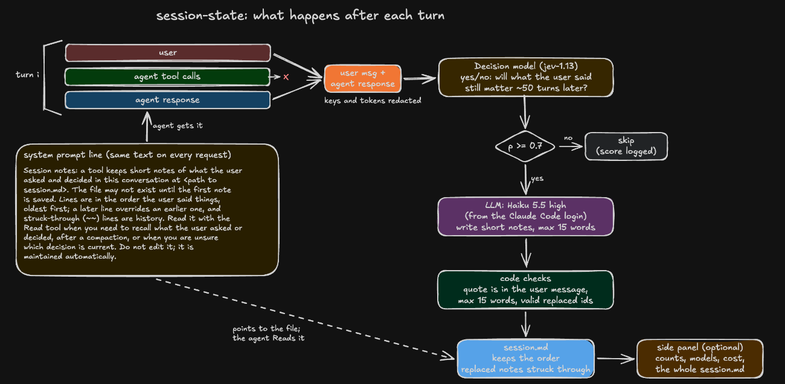

# session-state

A Claude Code mod that stops a long chat from losing what you asked and decided. After each turn it saves what you said that will still matter 50 turns later (decisions, preferences, requirements, corrections) as one short line in a `session.md`, marks requests as done once the agent reports them finished, and tells the agent where the file is. An optional side panel shows the notes, models, counts and cost.

## Install

In a Claude Code terminal session:

```
/plugin install session-state --marketplace kargarisaac/session-state
```

Answer `y` to add the marketplace, pick a scope, and paste your OpenRouter key when asked (it is stored as a secret). From a shell instead:

```bash
claude plugin install session-state --marketplace kargarisaac/session-state
```

The mod is active right away in that session and in every session you start after. After an update, run `/reload-plugins`. To try it from a clone without installing: `claude --plugin-dir <folder>`.

No OpenRouter key? Set the `gate` setting to `off` (see Privacy).

## Use

Work as usual. Notes appear after each turn that holds something lasting. Then:

- `/session-state` opens the side panel: counts, models, cost, and the whole `session.md`, scrollable.
- `/session-state close | pause | resume | retry | path` closes the panel, stops recording, resumes, re-runs failed turns, or prints the file path.
- Ask the agent "what did I decide about X?" and it reads the file.

The notes live in `~/.claude/session-state/<project>/<date>_<id8>.md`, with an `INDEX.md` per project. Delete or edit a line by hand and the change sticks.

```
- M-001 · t3 · decision · Haiku 5.5 via Claude Code subscription, not OpenRouter.
- ~~M-002 · t7 · decision · Store memories in a database.~~ → superseded by M-005
- M-005 · t12 · correction · Store memories in session.md; hand edits must stick.
- ~~M-006 · t13 · ask · Rename the video to Nablo Product Tour.~~ → done t15
```

## How it works



Per turn, tool calls are dropped. **Jev** (a yes/no decision model on OpenRouter) gates the turn; **Haiku 5.5 at high effort**, run on your Claude Code login (plan usage, not billed), writes the notes. Only what you said becomes a note, at most 15 words each, and a new note strikes through the one it replaces. Notes use the real names from the chat (`nablo-film-4k.mp4`, not "the video"). Code checks every note against your message before it is saved.

**Done requests.** When a turn is skipped by the gate but you still have open requests (`ask` notes), Haiku reads the agent's reply once, at low effort, and strikes through the requests it clearly reports as finished (`→ done t15`). On turns the gate passes, this comes in the same run as the notes. Rules and decisions are never marked done. This uses a little plan quota on turns with open requests; nothing more leaves Claude Code.

**What the agent is told.** Two things are added to the system prompt. The first is one fixed line, the same text on every request, so it costs one cache write:

> Session notes: a tool keeps short notes of what the user asked and decided in this conversation at `<path to session.md>`. The file may not exist until the first note is saved. Lines are in the order the user said things, oldest first; a later line overrides an earlier one, and struck-through (~~) lines are history. Read it with the Read tool when you need to recall what the user asked or decided, after a compaction, or when you are unsure which decision is current. Do not edit it; it is maintained automatically.

The second is your rules: the active `requirement` and `preference` notes (the newest 8), so the agent follows them without opening the file. It changes only when a rule is added or removed, and Claude Code then re-reads the chat once. Turn it off with `pinRules`.

## Settings

| Setting | Default | Meaning |
| --- | --- | --- |
| `openrouterKey` | empty | Jev key; falls back to `OPENROUTER_API_KEY` |
| `gate` | `jev` | `jev`, or `off` to let Haiku read every turn |
| `threshold` | `0.7` | Jev probability needed to save notes for a turn |
| `jevModel` | `jev-1.13` | OpenRouter model id for the gate |
| `haikuModel` / `effort` | `claude-haiku-5-5` / `high` | Extractor |
| `maxWords` | `15` | Longest note |
| `auditRate` | `0` | Share of skipped turns sent to Haiku anyway, to check the gate |
| `pinRules` | on | Put your rules in the agent's system prompt |
| `openPanelOnStart` | off | Open the panel with each session |

## Privacy

- With `gate: jev`, each turn's message and answer (keys and tokens redacted, text capped) go to OpenRouter and TypeSafe in the US.
- With `gate: off`, nothing leaves Claude Code; Haiku reads every turn and uses more plan quota.
- `prompt.compose` hooks do not run in organization-managed installs: there the agent is not told about the file, but the file and panel still work.
- The mod API is early access and may change between Claude Code versions.

## How well the gate works

Calibrated on 14 real chats (815 turns), labelled by LLMs with no human in the loop. At the default 0.7, 93 to 96% of saved notes were real on each half of the data, and about half of the important turns were saved: a quiet file over a complete one. Short replies like "yes, the second one" are weak (33% recall). The labels may share some of Jev's mistakes, so check the file over your first sessions. Details and the rerun commands are in [eval/REPORT.md](eval/REPORT.md) and `eval/`.

## Development

`core/` is host-free logic, `hooks/` the Claude Code adapter, `eval/` the calibration. Check with `claude plugin validate .` and `claude plugin test .`. To rerun the calibration on your own chats: `bun eval/build.ts`, `label.ts`, `score.ts`, `fit.ts` (set `EVAL_PROJECT_PREFIX` to pick project folders under `~/.claude/projects`; data stays in git-ignored `eval/data/`).
